# week5_business_source

- Source: `week5_business_source.pptx`
- Total slides: 25

## Slide 1

Business

## Slide 2

Theme 5: business

- Use examples from movies and real life to illustrate that 1)businesses can be glorious and promoting human progress, or 2) they are evil and wreaking havoc on the world. (It’d be ideal if these examples are from the same industry.)
- Is it possible for businesses to be more good than bad? If not, why? If yes, how?
- Will you consider the CSR (corporate social responsibility)/ESG (environment, social, governance) conduct of your future employer when you look for a job? Will you leave a company when you find it socially irresponsible?
- If you lead a business one day, will you prioritize profit or other goals? Why? How do your friends/classmates respond to this question?
- Will there be shopping malls in the future? If yes, who will go there for what? If not, why?

## Slide 3

Existential fear in movies: an evil business wants CONTROL

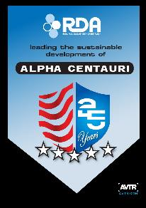

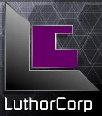

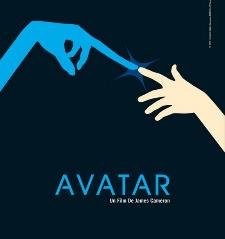

LuthorCorp, later renamed LexCorp, is an extensive billion-dollar corporation in Superman movies

Umbrella Corporation, the business giant in the game and movie Resident Evil series, used to be the biggest villain organization in the series.

The Resources Development Administration, or RDA, is the largest single non-governmental organization in human space in Avatar. The RDA has monopoly rights to all products shipped, derived, or developed from Pandora.

## Slide 4

2012 US Presidential Election

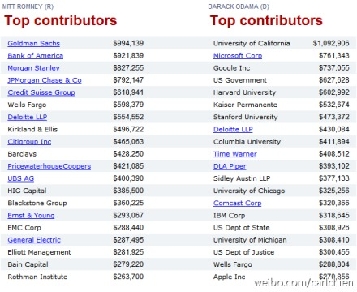

## Slide 5

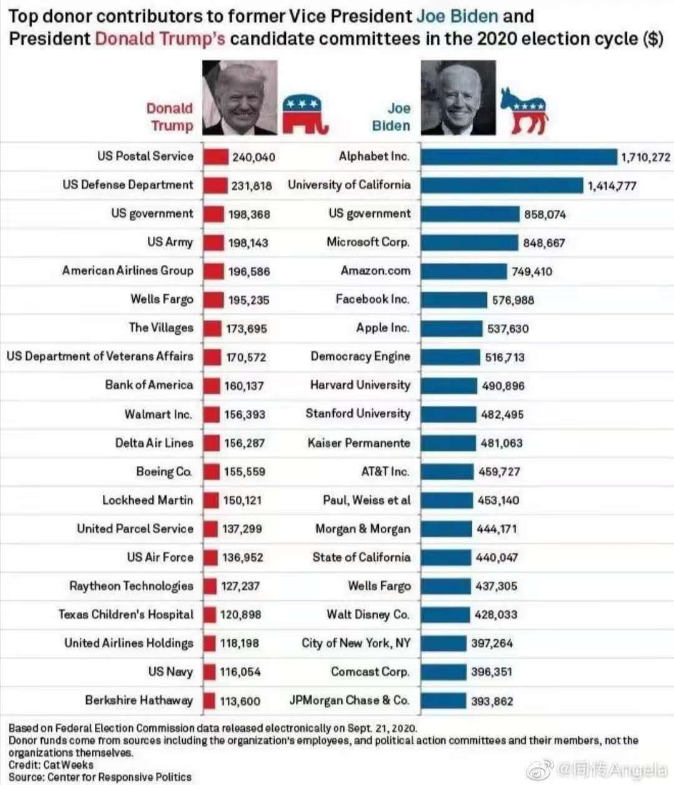

## Slide 6

Tech’s shift to Trump, 2025

- Elon Musk was Trump’s best friend for a while.
- Multiple Silicon Valley figures and companies each donated $1 million to Trump’s inauguration.
- Mark Zuckerberg — who Trump once threatened to imprison for life — has reset Meta by scrapping social media fact-checkers and restrictions on denigrating LGBTQ people, immigrants, and women.
- In response to Trump’s executive order to end federal DEI (diversity, equity and inclusion), tech companies like Amazon, Meta, Google cut DEI programs.

## Slide 7

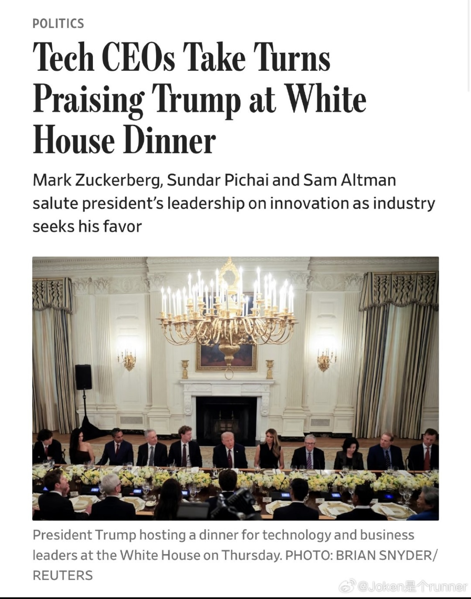

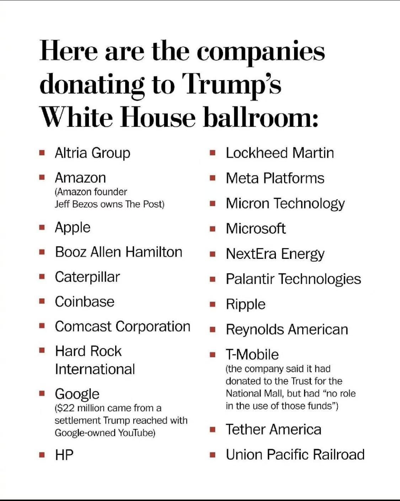

## Slide 8

Tech has learned to how to politick – the case of crypto businesses“Silicon Valley’s Influence Game”, by Charles Duhigg, The New Yorker, 10/14/2024

- Instead of partisanship, Silicon Valley giants and rich individuals support whichever politician that toes the line.
- They ran ads to attack opposing politicians, costing them seats in the US Congress.
- Pro-crypto donors are responsible for almost half of all corporate donations to PACs(政治行动委员会) in the 2024 election cycle.
- They claim to have a lot of Crypto Voters behind them (amplifying effect of online communities) and escalate the issue to national interest (“If we don’t do it, China is going to do it!”)
- Donald Trump: from “not a fan” to “chief crypto advocate”

## Slide 9

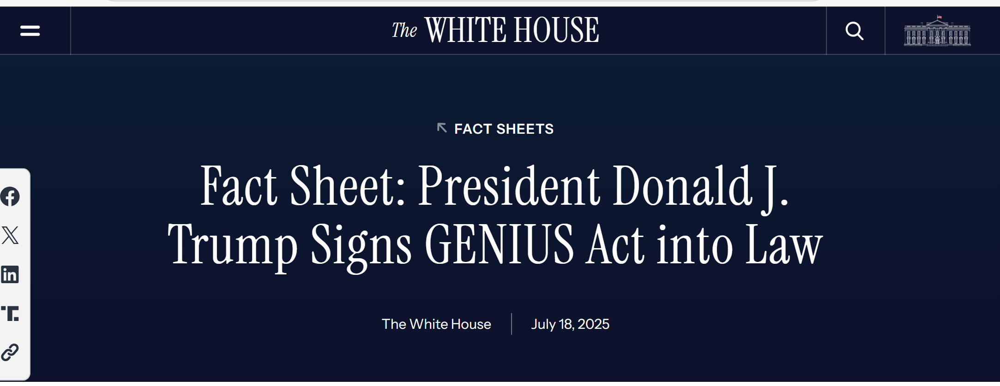

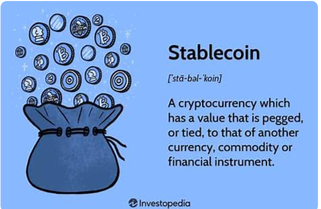

Legalization of

## Slide 10

Most Attractive Employers in China 2026 (field of study: engineering) (https://universumglobal.com/rankings/china/?tab=country&market=china&year=2026&mainfield=engineering&surveyType=ss）

| 1 | Huawei |
| --- | --- |
| 2 | TENCENT |
| 3 | Xiaomi |
| 4 | ByteDance |
| 5 | Alibaba |
| 6 | Apple |
| 7 | BYD |
| 8 | JD.com |
| 9 | Baidu |
| 10 | State Grid Corporation of China |

## Slide 11

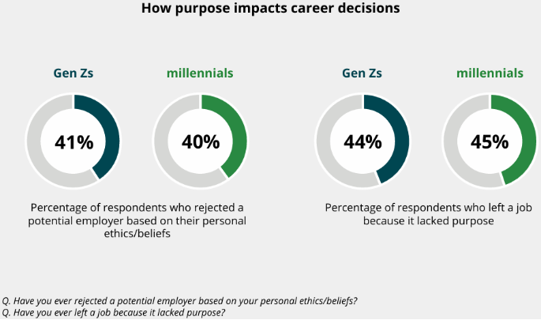

Source: Deloitte Global 2025 Gen Z and Millennial Survey

## Slide 12

Facebook has your data!

- Cambridge Analytica got Facebook data on 50 million Americans in 2015.
- This company allegedly used such data to manipulate public opinion (e.g. Trump’s election victory, Brexit)
- What else can they do with your data? （In 2024, Elon Musk encouraged users of X to upload their medical images to Grok, the platform’s A.I., for “analysis.” The company was later found to have made hundreds of thousands of chat transcripts accessible to search engines, often without permission.）

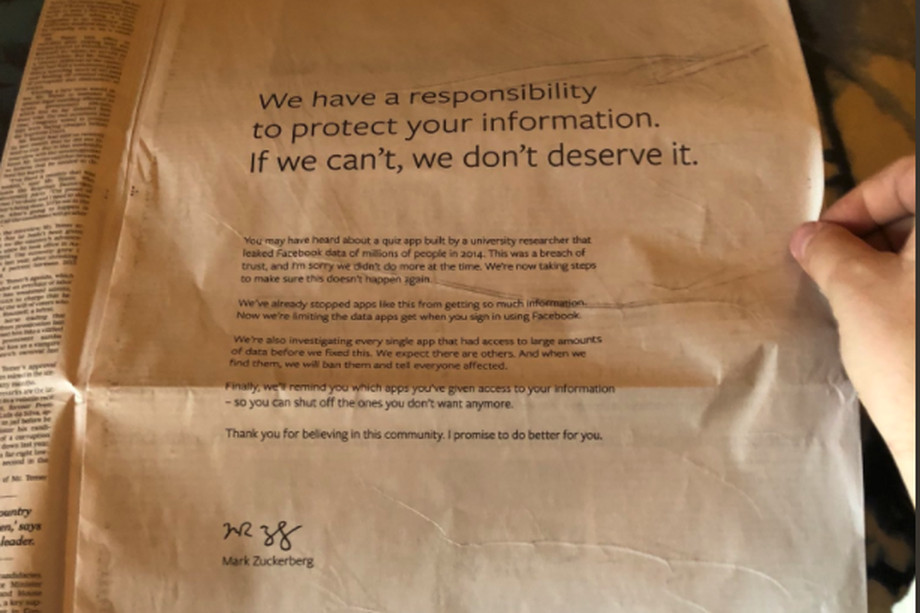

- Facebook’s full-page apology in several US
- and UK newspapers on 3/25/2018

## Slide 13

CNKI （中国知网）accused of monopoly (see eLearning article)

- CKNI went private after starting out as a government-supported national digitalization project. It is now China’s largest academic database.
- Between 2010 and 2016, CNKI raised its prices by an average of nearly 20% annually.
- Universities in China can hardly afford the annual subscription but they have to, because:
- -- As part of the graduating process, students are asked to license the
- digital copyright of their theses or dissertation to CNKI.
- -- The number of views and downloads of academic research on CKNI
- platform is the most important reference for academic achievements
- today.
- CNKI also has a notoriety of reprinting scholars’ work without their authorization.

## Slide 14

EpiPen for allergies to food, insect stings and latex

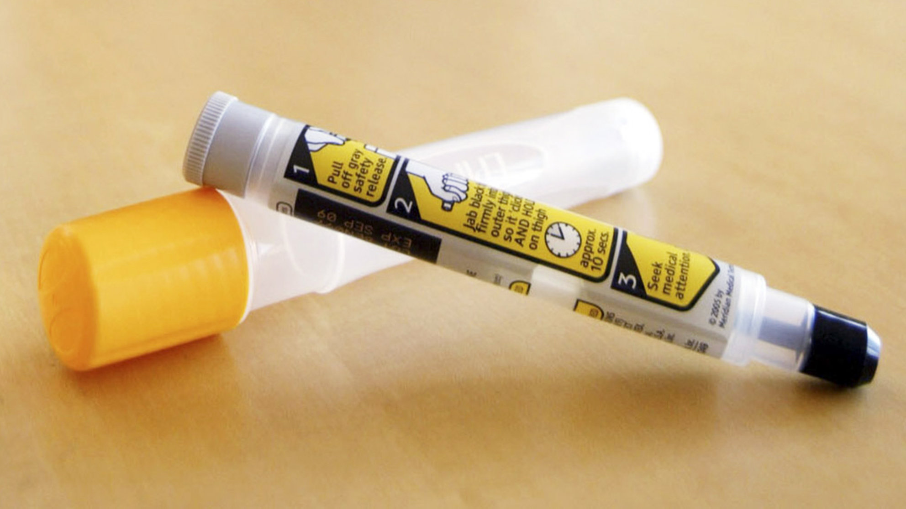

## Slide 15

Its price went up more than 600%.

- It’s an auto-injector of hormone epinephrine.
- Epinephrine cost about $1to make when Mylan acquired the pen patent in 2008.
- Mylan had no real competition in the market.
- Mylan raised the price from around $100 for the standard two-pack in 2008 to more than $735.
- Ephinephrine expires in one year.
- More than 15 million Americans suffer from food allergy. And there are other allergies…

## Slide 16

Modern Times (1936)(00:01:26– 00:11:17)

- Business is evil.
- Businessmen have no heart.
- Workers are machines.

## Slide 17

Modern Times movie plot

Chaplin's last 'silent' film, filled with sound effects, was made when everyone else was making talkies. Charlie turns against modern society, the machine age, (The use of sound in films ?) and progress. Firstly we see him frantically trying to keep up with a production line, tightening bolts. He is selected for an experiment with an automatic feeding machine, but various mishaps leads his boss to believe he has gone mad, and Charlie is sent to a mental hospital - When he gets out, he is mistaken for a communist while waving a red flag, sent to jail, foils a jailbreak, and is let out again. We follow Charlie through many more escapades before the film is out.

## Slide 18

Silicon Valley

- What is it like working for a big high-tech company?
- (Episode 3, Season 3)
- Richard and his two friends started a small company focusing on compression algorithm, but their new CEO wants it to “go enterprise” – to put this algorithm into a box solution for enterprises.

## Slide 19

Big is evil, small is beautiful,the cycle of competition

- In 1949, British author George Orwell wrote a novel entitled 1984 to warn people against a Big Brother society where the state exercises mind control.
- Apple’s 1984 Macintosh Super Bowl TV commercial
- -- Apple, the newcomer into PC industry, challenges the Big Brother.
- Motorola’s Super Bowl 2011 commercial
- -- Apple, now the “white terror”– the Big Brother, is challenged.

## Slide 20

Why against monopoly?

- Food Inc. (2008) 1:06:27 – 1:18:00 Monsanto Company(孟山都公司)
- A former chemistry company that produced the notorious Agent Orange during the Vietnam War, transformed itself into agricultural biotechnology company that sells two types of mutually reinforcing products：its weed killers kill any crop but its own GM (genetically modified) crop. Farmers are forced to buy its patented seeds annually. As a result, 90% of the market of transgenic seed is controlled by Monsanto around the world.

## Slide 21

Food Inc. plot summary

The current method of raw food production is largely a response to the growth of the fast food industry since the 1950s. The production of food overall has more drastically changed since that time than the several thousand years prior. Controlled primarily by a handful of multinational corporations, the global food production business - with an emphasis on the business - has as its unwritten goals production of large quantities of food at low direct inputs (most often subsidized) resulting in enormous profits, which in turn results in greater control of the global supply of food sources within these few companies. Health and safety (of the food itself, of the animals produced themselves, of the workers on the assembly lines, and of the consumers actually eating the food) are often overlooked by the companies, and are often overlooked by government in an effort to provide cheap food regardless of these negative consequences. Many of the changes are based on advancements in science and technology, but often have negative side effects.The products made have been shown in several studies to enlarge male sexual organs and increase male breast size. The answer that the companies have come up with is to throw more science at the problems to bandage the issues but not the root causes. The global food supply may be in crisis with lack of biodiversity, but can be changed on the demand side of the equation.

## Slide 22

Business leaders made “good vs. bad” decisions

## Slide 23

US CDC: From 1999-2021, nearly 645,000 people died from an overdose involving any opioid, including prescription and illicit opioids

## Slide 24

Painkiller (2023)

- Painkiller exposes the roots of the most pressing health epidemic of the 21st century. Powerful narcotic painkillers, or opioids, were once used as drugs of last resort for pain sufferers.
- Beginning in the 1990s, Purdue Pharma turned OxyContin, a fiercely addictive painkiller (which is actually heroin), into a billion dollar blockbuster.
- It relied on two “winning” strategies
- -- Claiming only 0.3% of users get addicted
- -- Sending beautiful saleswomen to persuade doctors to prescribe and to
- increase dosage
- A Jan. 2025 settlement bars the Sackler family from selling opioids in the U.S. and ends its control of Purdue Pharma. The family and the company must pay $7.4 billion in damages. The company is in bankruptcy. The family may face further lawsuits.

## Slide 25

Painkiller (2023)

- Episode 02
- 03:00 – 04:46 Shannon the newbie got called “OxyContin Kitten”
- 09:52 – 13:52 Shannon was kicked out of a clinic
- 19:27 – 21:20 Shannon scored with Dr. Cooper
- Episode 03
- 15:45 – 16:38 Shannon at company training
- 19:43 – 21:22 Shannon persuaded Dr. Cooper to up the dosage
- 25:54 – 29:48 Shannon took notes of two girls high on OxyContin
- Episode 04
- 1:42 – 3:43 Shannon summoned to company headquarters
